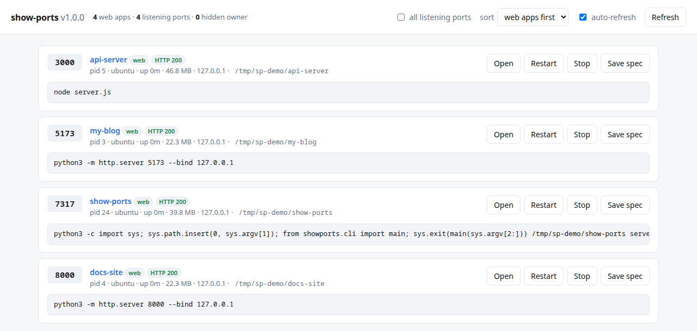

# show-ports

Shows every web app running on this machine, the port it listens on, and the
command that launched it — and lets you stop, start and restart them.

Works as a terminal tool and as a local web dashboard. Linux only (it reads
`/proc`).



*Screenshot taken in an isolated network namespace with three demo servers.*

## Features

- Lists listening TCP ports with pid, user, uptime, memory, working directory
  and the exact launch command.
- Identifies what is on each port by talking to it (HTTP, SSH, MySQL,
  PostgreSQL, Redis, SMTP, ...), not by guessing from the port number.
- Stop / start / restart any of your own services, even after they were
  killed, by snapshotting the launch spec first.
- Tells systemd-managed services apart from orphaned dev servers by reading the
  process cgroup, not the parent pid.
- Token-protected local dashboard with auto-refresh, plus `--json` output.

## Quick start

```bash
git clone <this repo> && cd show-ports
python3 -m pip install --user psutil flask
./show-ports              # terminal table
./show-ports serve        # dashboard on http://127.0.0.1:7317/
```

```
./show-ports                # list the web apps
./show-ports serve          # dashboard on http://127.0.0.1:7317/
```

## Requirements

Python 3.10+, `psutil`, and `flask` (only for `serve`):

```bash
python3 -m pip install --user psutil flask
```

The `show-ports` script picks the first interpreter that can actually import
what the command needs (`flask` only for `serve`), so a Homebrew or pyenv
`python3` on your PATH won't break it. Override with
`SHOW_PORTS_PYTHON=/path/to/python`.

### Running under sudo

`sudo` sets `HOME=/root`, so your `pip --user` packages vanish even though they
are installed — which is why `sudo ./show-ports serve` would otherwise fail on
`flask` while `sudo ./show-ports list` works (psutil also comes from apt). The
launcher handles this: under sudo it falls back to the invoking user's
site-packages directory and says so. It refuses that directory if it is
group- or world-writable, since root importing code from a path other accounts
can write to is a privilege-escalation route.

Under `sudo` the dashboard runs as root and can therefore stop anything on the
machine, with the session token as the only gate. Prefer `sudo ./show-ports list`
when you just need to see who owns the hidden ports.

## Commands

| Command | What it does |
|---|---|
| `show-ports` / `list` | Listening services that answer HTTP, with pid, user, uptime, memory and command |
| `list -a` | Every listening TCP port, including databases and system services |
| `list -v` | Also show the working directory and the managing systemd unit |
| `list --sort X` | Sort by `web` (default), `port`, `name`, `user`, `uptime` or `memory`; `--reverse` flips it |
| `list --json` | Machine-readable output |
| `serve` | Web dashboard (`-p PORT`, `--host`); accepts `?all=1&sort=port` in the URL |
| `capture <port>` | Save a running service's launch spec so it can be restarted later |
| `stop <port\|pid\|id>` | SIGTERM the service and its children, SIGKILL what survives |
| `start <port\|id>` | Launch a saved service again |
| `restart <port\|pid\|id>` | Stop, wait for the port to free, then start |
| `logs <port\|id>` | Output of a service that show-ports started |
| `forget <id>` | Delete a saved launch spec |

Targets are interchangeable: a port, a pid, or a saved spec id all work.

## What each port is actually running

Services are identified by talking to them, not by looking up the port number —
so MySQL on 3307, or SSH on 33004, is still reported as MySQL and SSH.

Ports that greet you first (SSH, MySQL/MariaDB, SMTP, IMAP, POP3, FTP, VNC) are
identified from that greeting, along with their version. Ports that expect the
client to speak first are asked: an HTTP `GET`, a PostgreSQL SSLRequest, a Redis
`PING`, a memcached `version`. On a port whose usual occupant speaks a binary
protocol, the specific probes run before the HTTP one, so a stray `GET` doesn't
land in your database log.

A name with no qualifier was **verified** by conversation; a trailing `?` means
it is only a guess from the port number:

```
  3306   no  MySQL 8.0.45        <- verified, version came from the server
 33004   no  SSH OpenSSH_9.2p1   <- verified, on a non-standard port
  9050   no  Tor SOCKS           <- guessed from the port (shown as "Tor SOCKS?" in the dashboard)
```

The `WEB` column (and `is_webapp` in `--json` and the API) says whether the port
answered HTTP. `--sort web` puts the web apps first; the dashboard has the same
control.

## How restart survives a kill

Once a process dies, the kernel forgets its command line, working directory and
environment — so there is nothing left to relaunch from. show-ports therefore
**snapshots the launch spec before it kills anything**, and stores it in
`~/.config/show-ports/registry.json`.

That snapshot includes the process environment, because most dev servers need it
(`PATH`, `VIRTUAL_ENV`, `NODE_ENV`, API keys). The file is written `0600`, but it
does mean **secrets from a service's environment are stored on disk in plain
text**. To opt out, pass `--no-env` to `stop`, `restart` or `capture`, or run
`serve --no-env`; restarts then use your current shell environment instead, which
is less faithful.

Restarted services are detached with `start_new_session=True`, so they outlive
show-ports itself. Their output goes to `~/.local/state/show-ports/logs/<id>.log`.

## What it will not do

- **Processes owned by other users** (usually root) are listed, but their command
  and controls are hidden — the kernel won't reveal them to an unprivileged
  process. Run under `sudo` to see and manage those.
- **Protected system processes** (`sshd`, `systemd`, `Xorg`, `NetworkManager`, …)
  are refused, since killing them would end your session. `--force` overrides.
- **pid 1, and show-ports' own process group**, are always refused.
- **systemd-managed services** are flagged with the unit that owns them and the
  `systemctl` command to use instead. Stopping one here may just get undone by
  its manager.

A process whose parent is pid 1 is *not* assumed to be a systemd service —
show-ports reads its cgroup, so an orphan whose launching shell exited is
correctly reported as unmanaged rather than as a unit.

## Dashboard safety

`serve` binds to `127.0.0.1` and mints a random token per run. Every endpoint
that changes state requires that token in an `X-ShowPorts-Token` header and
rejects cross-origin requests, so another page in your browser cannot use the
dashboard to kill your services. Binding to a non-loopback address prints a
warning: anyone who can reach the host could then stop and start things.

## Layout

```
show-ports                 entry point
showports/scan.py          port discovery, HTTP probing, cgroup/supervisor detection
showports/registry.py      persisted launch specs
showports/actions.py       stop / start / restart, with the safety guards
showports/web.py           Flask dashboard + JSON API
showports/cli.py           command line
```

## Tech stack

Python 3.10+, psutil, Flask, a single dependency-free HTML/JS page for the
dashboard, and a Bash launcher that picks a working interpreter.

## Status / limitations

- Linux only; tested on Ubuntu 22.04 with XFCE/X11 and systemd.
- Without root, ports owned by other users show up with their owner hidden.
- No automated test suite yet; verified by running `list`, `list -a --json` and
  `serve` against demo servers.
- The Flask development server is used for the dashboard; it is meant for
  loopback use only.

## License

MIT, see [LICENSE](LICENSE).
